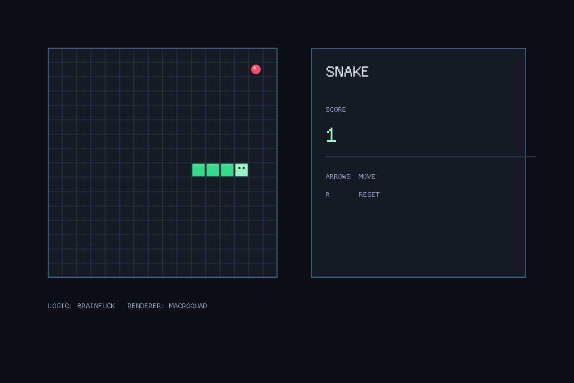
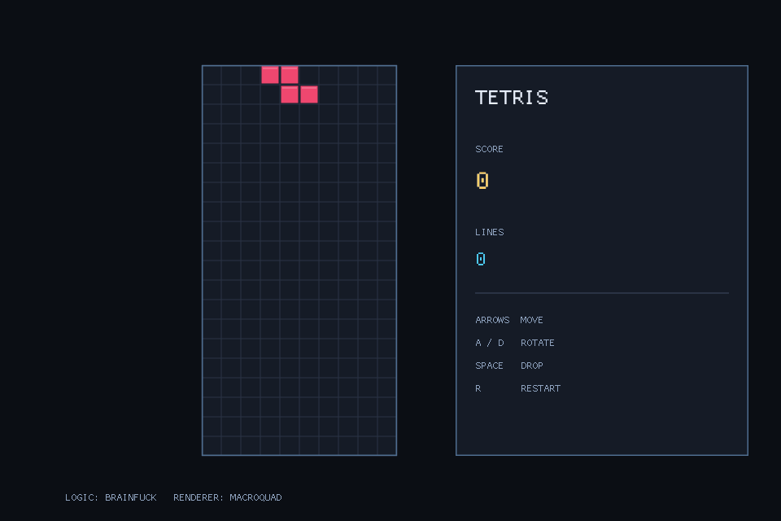
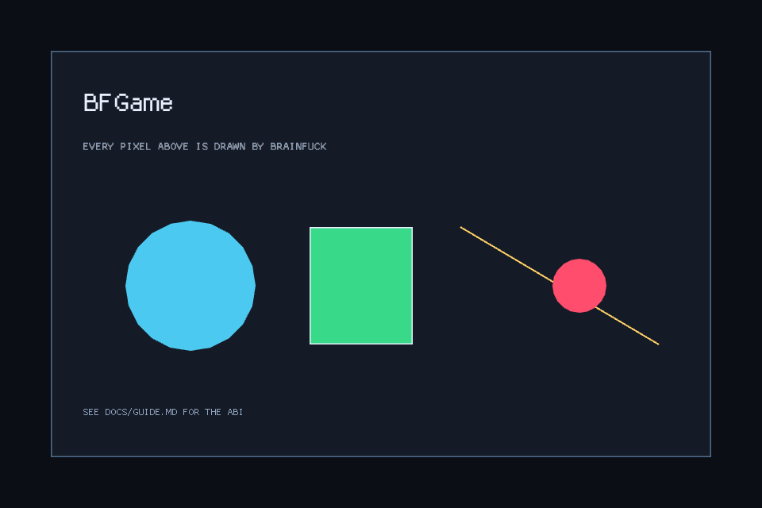

# BFGame

> GitHub: <https://github.com/source27/bfgame>

一个用 Rust 写的迷你游戏引擎：**渲染和输入由 macroquad 提供，游戏逻辑完全跑在 Brainfuck 虚拟机里**。

它不是“Rust 写游戏、顺手塞一段 BF 当彩蛋”。蛇的移动、碰撞、吃食物、俄罗斯方块的旋转、消行、计分，全部由 `games/*.bf` 中的纯 Brainfuck 代码控制。Rust 只负责：

- 一个 64 KiB 的 Brainfuck 虚拟机和 40M 指令/帧的预算；
- 手柄/键盘输入 → 固定内存映射寄存器；
- 绘制命令队列 → macroquad 画布；
- 一块让 BF 可以按下标访问的小型堆内存（32 × 256 字节）。

| 贪吃蛇（得分 1） | 俄罗斯方块 |
| --- | --- |
|  |  |

| 基础绘图 demo |
| --- |
|  |

## 快速开始

需要近期 stable Rust（开发验证使用 rustc 1.99）和 Windows MSVC 工具链。仓库内已经带了裁剪过的离线依赖，因此可以直接：

```powershell
cargo build --release --offline
.\target\release\bfgame.exe snake.bf
.\target\release\bfgame.exe tetris.bf
```

想在任何目录直接输入 `bfgame snake.bf`，安装到 Cargo 的 bin 目录：

```powershell
cargo install --path . --offline
bfgame snake.bf
bfgame tetris.bf
```

`snake.bf` 和 `tetris.bf` 会优先找当前目录/`games/` 下的真实文件；找不到时使用编译进二进制的内置版本。

也可以直接运行绘图 demo：

```powershell
.\target\release\bfgame.exe examples\hello.bf
```

截图（`--frames` 是显示帧数，截最后一张）：

```powershell
.\target\release\bfgame.exe snake.bf --frames 3 --screenshot docs\snake-score.png
```

其他选项：

```text
--tick-ms N          逻辑 tick 长度，默认 120ms
--budget N           每帧最多执行多少条 BF 指令，默认 40,000,000
--seed N             固定随机种子
--frames N           显示 N 帧后退出
--screenshot PATH    保存最后一帧为 PNG
--help
```

## 操作

| 游戏 | 按键 |
| --- | --- |
| Snake | 方向键转向；`R` 重开；`Esc` 退出 |
| Tetris | `←` / `→` 移动；`↓` 软降；`A` / `D` 顺时针旋转；`Space` 硬降；`R` 重开；`Esc` 退出 |
| 通用 | 关闭窗口或 `Esc` 退出 |

## 项目结构

```text
src/
  abi.rs       内存映射 ABI、绘制命令、调色板
  vm.rs        Brainfuck 解释器（预计算跳转、YIELD、MMIO）
  game.rs      输入、tick、随机数、每帧预算
  render.rs    macroquad 渲染器
  builtin.rs   内置游戏查找
  options.rs   CLI
  main.rs      窗口与主循环
games/
  snake.bf     纯 BF 可执行游戏（约 180 KB）
  tetris.bf    纯 BF 可执行游戏（约 1.7 MB）
  src/*.bfa    带注释的 BF 宏汇编源文件
tools/bfasm.py BF 宏汇编器：.bfa → 纯 .bf
examples/      hello demo
docs/GUIDE.md  详细指南：ABI、BF 编程、两个游戏的实现
tests/         无窗口的逻辑/渲染命令测试
```

## 测试

```powershell
cargo test --offline
```

测试会直接用无窗口的 VM 运行两个 `.bf` 游戏，覆盖：初始化绘制、墙壁死亡、重开、吃食物计分、Tetris 移动/旋转、硬降、单行/双行消除、堆叠到 game over。

## 设计要点

- **纯 Brainfuck 运行时**：`bfgame` 只接受 `+-<>[],.` 八种指令；`.bf` 里的注释和其他字符会被忽略。
- **YIELD 帧协议**：BF 程序在每帧写 `CMD=10` 并触发 `EXEC`，VM 暂停，宿主渲染，再在下一次 `next_frame` 后恢复。静态画面不需要每帧重画。
- **retained display list**：绘制命令会保留到下一次 `CLEAR`；游戏只在状态变化时重画。
- **小型堆**：标准 BF 只能顺序移动指针，按下标访问数组很痛苦。引擎提供 `LOAD/STORE/FILL` 访问 32 个 256 字节 arena；蛇身队列和俄罗斯方块棋盘都放在这里。
- **宏汇编器**：Brainfuck 没有变量名和结构化控制流。`tools/bfasm.py` 把 `.bfa` 展开成纯 BF；它只是开发工具，运行时不参与。

更完整的内存映射、命令表、汇编语法和游戏逻辑说明见 **[docs/GUIDE.md](docs/GUIDE.md)**。

## 已知限制

- 8 位数字：分数上限 255，没有 16 位计分。
- 没有音频、精灵图、透明混合和通用 UI 系统。
- Tetris 是简化版：不做 wall kick，O 块不旋转，每次随机出块，没有 next 预览。
- 为了离线构建，`vendor/` 和 `.cargo/config.toml` 被保留；在 Windows MSVC 上验证。若要在其他平台构建，删掉 `.cargo/config.toml` 使用在线 crates.io 即可（GNU Windows 的两个 stub crate 不是真实实现）。

## License

示例代码可自由使用和修改。macroquad、miniquad 等依赖保留其原始 MIT/Apache-2.0 许可证。
